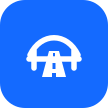

# One Android app

SubaruBridge 0.57 brings the everyday Android features into the existing
`org.subarubridge.app` application. The Garage, head-unit dashboard, integrations,
connection checks and new recorder share one installation. Its original adaptive
blue bridge-and-road icon supports round and themed Android launchers.

## Where things live

| Earlier workflow | Unified location |
| --- | --- |
| SubaruBridge ownership app | Home → Garage: existing local records, maintenance, fuel, expenses, trips and summaries |
| STARLINK research dashboard | Dashboard: original HTML/CSS, appearance, apps and four display/touch/phone/result checks |
| Separate phone integrations | Home → Apps & integrations: Android media, directions, call/message preparation and notification options |
| Lab recorder requiring laptop arming | Home → Record & diagnose → Start recording: original app metadata, with no helper or PC |
| Lab event markers and notes | Record & diagnose → Mark car event / Add private observation |
| Private recording export | Record & diagnose → Export private diagnostics ZIP, or Tools → Export private report |
| Lab passive USB capture | Record & diagnose → Show technical details: USB states, interface counts, phone resources and permission state |
| Experimental USB/AirPlay/CarPlay receiver | Earlier source and data preserved separately; not included as a verified replacement connection |

The independent app has its own Bluetooth listener and Rust transport. It does
not launch, embed or require the official STARLINK APK, private research clone,
vendor SDK, Python runtime or PC backend. Vehicle ownership works without Bluetooth.
The actual Subaru must still verify the independent transport's display, input
and reconnect behavior. A phone self-check does not establish those results.

## Record a parked-car test

1. Open SubaruBridge. Allow Nearby devices when asked and pair using the normal
   Android/car Bluetooth settings. Wait for **Ready to connect**.
2. Open **Home → Record & diagnose → Start recording**. Wait for **Recording**.
   There is no laptop arming step. You can leave this screen; a notification keeps
   the recording visible and provides **Stop and save**.
3. With the car parked, connect its Bluetooth and open **Apps → STARLINK** on the
   head unit. Use the display, touch, phone and results checks. Record only what
   you actually observed using **Mark car event** or a private note.
4. Return to **Record & diagnose → Stop and save**. Open a saved recording to
   inspect its newest 60 events. Export the private ZIP if you want to share it.
5. Review the report before sharing. It includes notes and app diagnostics.
   Garage records, notification bodies, packet payloads and device addresses are
   not collected automatically. Notes contain what you enter. The ZIP is not encrypted.

Recordings stop after ten minutes or one MiB. Twelve sessions are retained;
starting another removes the oldest app recording. Partial sessions survive a
process interruption and are labeled **interrupted**, never **saved**. Recording
does not restart Bluetooth or change system HCI logging settings. Exact packet
analysis still needs an independently collected, privileged HCI trace.

**Run phone self-check** checks the native Rust transport, shared maintenance
engine, actual loopback HTTP dashboard and rejection of remote HTTP targets. It
does not operate music controls, send messages, place calls or transmit to a car.

## Older installations and data

Upgrading the same application ID preserves its Garage and settings. Android
separates other apps' sandboxes, so this build does not silently read or erase
older Lab/research data. Developer mode lists known older copies and opens their
system app-info pages. Keep older listeners closed to avoid a competing service.
Do not clear data or uninstall an old copy before preserving recordings you need.

On the development Pixel, old private data is backed up locally before duplicate
copies are disabled. Disabling keeps their data and is reversible. The proprietary
research application and old captures remain outside the public repository.

MirrorLink descriptor acceptance/certification, AirPlay receiver and CarPlay relay
experiments are not silently claimed to work in this build. The earlier working
bench code is preserved; their transport and source/dependency integration need
separate review and tests. Daily STARLINK-path operation needs only SubaruBridge.

## Portable architecture

Shared Rust owns vehicle records, calculations, protocol framing and capability
evidence. Android owns permissions, Bluetooth sockets, notifications and file I/O.
Recorder schema 1 uses JSON session headers and JSONL events: each event carries
`schema`, `event`, `timeMs`, `uptimeMs` and bounded event-specific fields. Times are
integer milliseconds; phone samples and manual observations have distinct kinds.
Session headers distinguish `recording`, `saved`, `interrupted`, `time_limit`,
`storage_limit`, `storage_error` and `system_time_limit` outcomes.
Connection-check events preserve their preview, self-check or Bluetooth source.
Bluetooth alone does not prove the peer was the physical Subaru; synthetic radio
tests and actual car observations remain separate evidence.

An iOS adapter can use these formats and shared models, but must use authorized
iOS transports and background APIs. Android notification listeners, Classic RFCOMM
and system HCI access do not become ordinary iOS capabilities by sharing code.
iOS implementation remains paused while this Android consolidation is validated.
